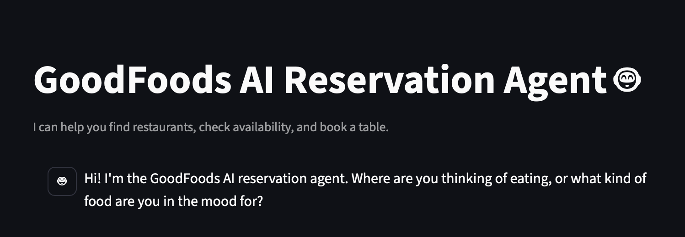
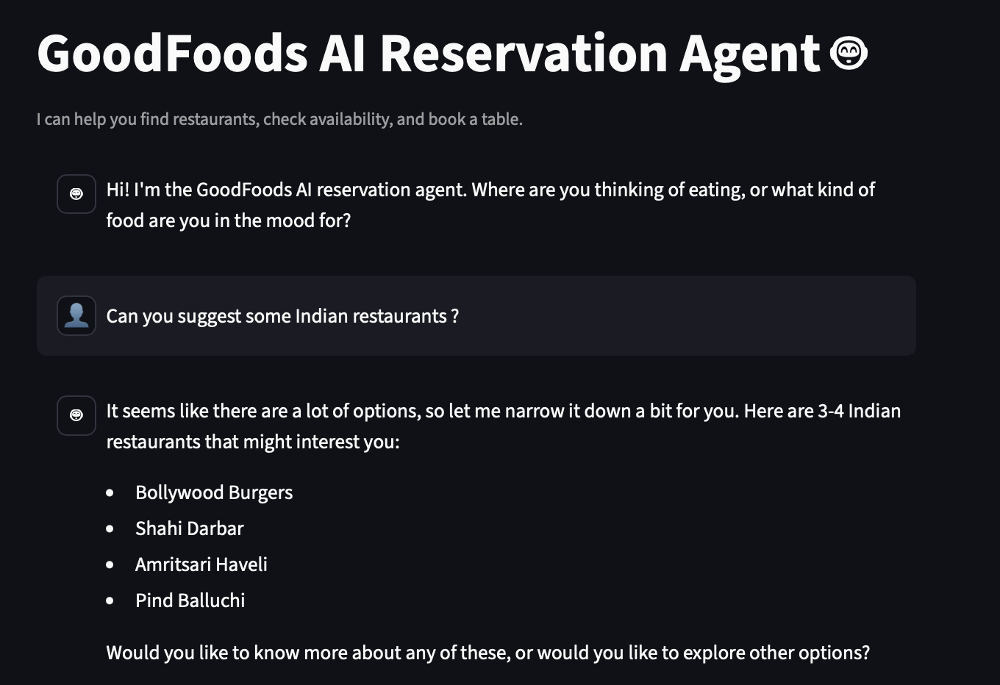
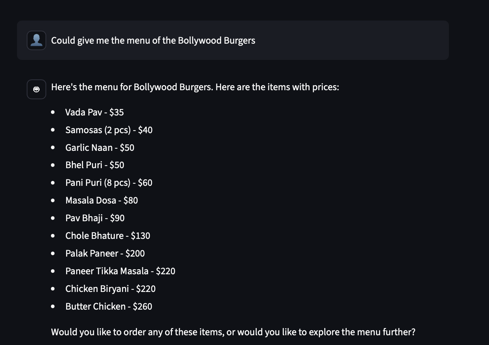
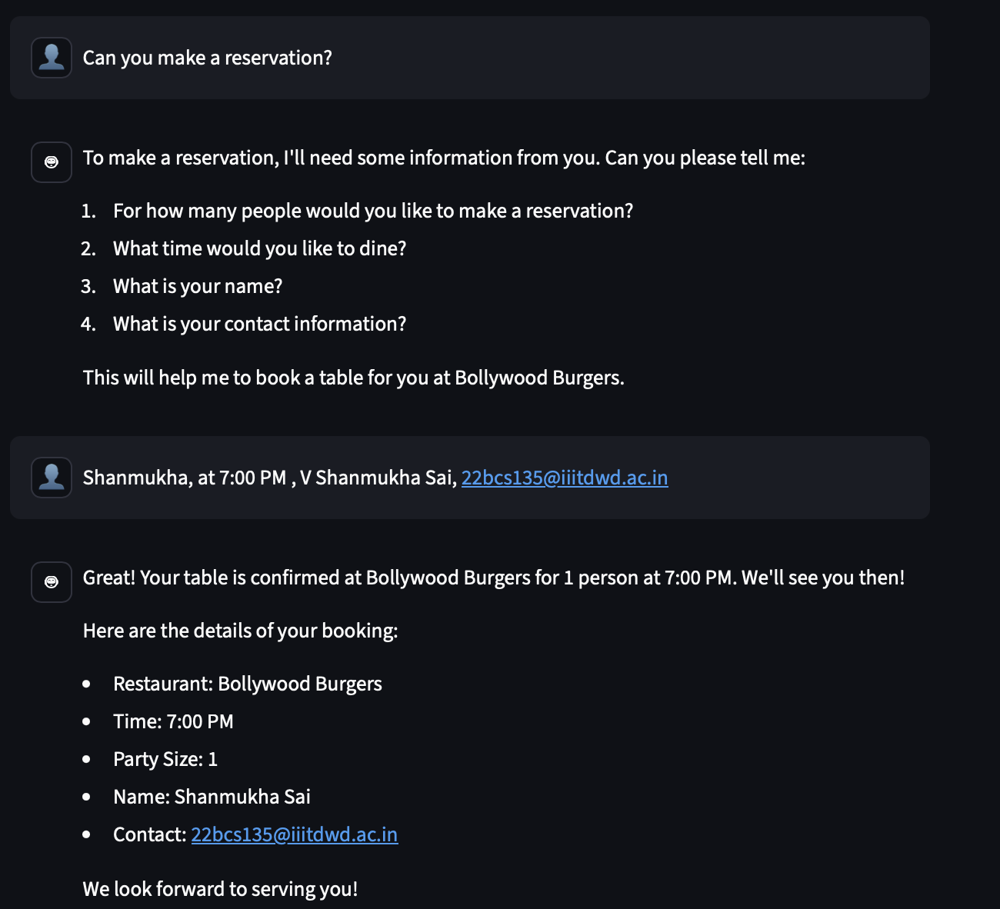
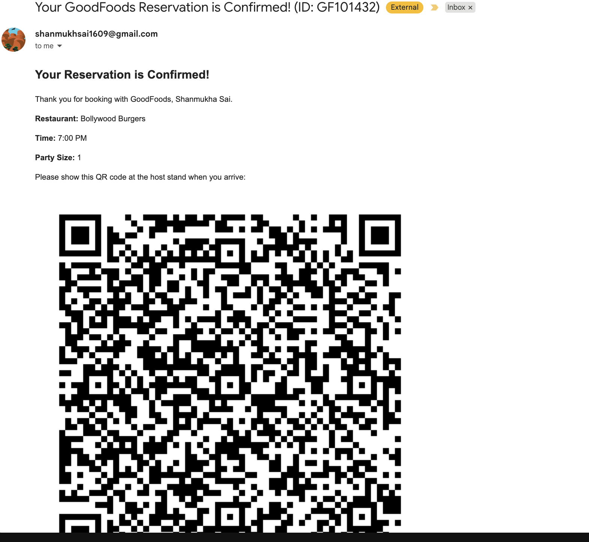

# GoodFoods AI Reservation Agent

This project is a conversational AI agent designed for the GoodFoods restaurant chain. It leverages the Cerebras API (using the llama-3.1-8b model) and a tool-calling architecture to handle user requests for finding restaurants, checking menu items and prices, verifying table availability, and making reservations. The agent is built using Python with a Streamlit frontend and includes features like budget-aware recommendations and automated QR code email confirmations.

## Demo Video

(Must) Please include a link to your screen recording demonstrating the agent's functionality:
[](./images/GoodFoodsAIAgent.mp4)
[Link to Demo Video Here]

## Features

- **Natural Language Understanding**: Handles conversational requests for restaurant discovery and booking.

- **Tool-Calling Architecture**: Uses specific Python functions (tools.py) for reliable database interactions (searching, checking, booking).

- **Intelligent Recommendations**: Suggests restaurants based on cuisine, location, and user-specified budget.

- **Real-Time Availability Checks:** Queries the database (restaurants.json) to confirm table availability. (See Limitations regarding true real-time sync)

- **End-to-End Booking**: Gathers necessary user details and confirms reservations.

- **Automated QR Code Confirmation**: Sends an email with booking details and a unique QR code upon successful reservation.

- **Conversational Error Handling**: Gracefully handles missing information and LLM formatting errors.

### Setup Instructions

- Clone the Repository:
``` (shell)
git clone <your-repo-url>
cd <your-repo-folder> `
```

- Create a Virtual Environment:
``` (shell)
python -m venv venv 
```

- Activate the environment
On Windows
``` (shell)
.\venv\Scripts\activate 
```
On macOS/Linux:
``` (shell)
 source venv/bin/activate 
```

- Install Dependencies:
``` (shell)
pip install -r requirements.txt
```
- Configure Environment Variables:
- Create a file named .env in the project's root directory.
- Add your API keys and email credentials:
``` (shell)
CEREBRAS_API_KEY="your-cerebras-key..." 
SENDER_EMAIL="your.email.address@gmail.com"
SENDER_APP_PASSWORD="xxxx-xxxx-xxxx-xxxx"
```

- Run the Streamlit Application:
``` (shell)
streamlit run app.py
```
The application should open in your default web browser.

## Documentation of Prompt Engineering Approach

- The agent's behavior is primarily controlled by the SYSTEM_PROMPT variable within agent.py. The prompt engineering strategy evolved iteratively based on observed LLM failures:

- **Core Instructions**: Define the agent's persona (helpful reservation agent) and primary goal.

- **Tool Specification** : Clearly list all available Python tools (find_restaurants, get_menu, etc.) with their exact function names and expected arguments (using camelCase as the LLM prefers it). Specify the expected format of the TOOL_RESULT where critical (e.g., find_restaurants returns names, get_menu returns sorted items).

- **Strict Output Formatting**: Mandate that the entire LLM response must be a single, valid JSON object, providing explicit examples for both tool_call and final_answer formats. This was crucial to prevent the LLM from "leaking" raw text or malformed responses.

- **Conversational Rules**: Provide explicit instructions for handling specific scenarios:

- **Summarizing Long Lists**: Instruct the LLM not to dump entire lists (like 75 restaurants) but to summarize and present 3-4 options.

- **Displaying Menus**: Force the LLM to present the full menu as an itemized list (using Markdown) and explicitly forbid summarization (e.g., "The main courses start at...").

- **Handling Missing Booking Info**: Instruct the LLM to ask for missing parameters (partySize, time, userName, userContact) before attempting to call book_table. Added specific examples of how to phrase these questions.

- **Booking Confirmation**: Instruct the LLM on how to convert the book_table confirmation JSON into a friendly, conversational message, explicitly forbidding the repetition of TOOL_RESULT or raw JSON.

- **Robust Parsing in Code**: While the prompt aims for perfect formatting, the call_cerebras_llm function in agent.py includes robust parsing logic to extract JSON even if the LLM includes extraneous text. It also wraps raw text responses as final_answer to prevent UI errors.

- **Programmatic Guardrails**: The run_conversation_turn function includes a "guardrail" to programmatically check if all required arguments for book_table are present and non-empty before calling the tool, overriding the LLM if necessary. This acts as a final safety net.

This combination of strict prompting, robust parsing, and programmatic validation proved necessary to create a reliable agent.

## Example Conversations (User Journeys)

(Please replace the placeholder links/text with your actual screenshots)

- **Successful Restaurant Discovery & Menu Inquiry**:


User finds an Indian restaurant, asks for the menu.

- **Retrieving the Menu for a restaurant** :

User asks for a specific menu.

- Availability Check & Successful Booking with QR Code:
User checks availability, provides details, and completes booking.


User receives email confirmation.


Handling Missing Information During Booking:
User says "Book it" without providing details. Bot asks for missing info.

Graceful Failure (Restaurant Not Found):
User asks for a cuisine type the chain doesn't offer.

## Business Strategy Summary 

The GoodFoods AI Reservation Agent aims to automate bookings, reducing staff workload (target 60% reduction in phone time) and eliminating manual errors. Key opportunities lie in reducing revenue loss from no-shows (target 25% decrease via QR code reminders) and increasing conversions (target 80% completion) by being available 24/7. Long-term, the agent builds a customer database, enabling personalized marketing and potentially increasing off-peak bookings (target 15% increase) through proactive offers.

### Unique Competitive Advantages:

- **Frictionless QR Code Check-in**: Enhances customer experience and operational efficiency at the host stand.

- **Budget-Aware Recommendations**: Goes beyond simple booking to act as a helpful dining consultant.

- **Proactive Error Prevention**: Programmatic guardrails ensure booking reliability even if the LLM makes mistakes.

- **Vertical Expansion**: The core architecture (LLM + Tools + Database) can be adapted for any appointment-based business (salons, clinics, services) or licensed as a SaaS solution for other restaurant chains.

## Assumptions, Limitations, & Future Enhancements

### Assumptions:

- The restaurants.json file accurately represents the restaurant details (menus, capacities).

- The user providing an email address during booking implies consent to receive the confirmation email.

## Limitations:

- **No Real-Time Inventory Sync**: This is the most significant limitation. The restaurants.json file is static between agent restarts and does not sync with real-time table occupancy changes from walk-ins or POS system updates. This creates a risk of double-booking.

- **LLM Reliability**: While heavily prompted and guarded, the LLM can still occasionally misunderstand nuances or fail to follow formatting perfectly, requiring robust error handling in the Python code.

- **Basic Email Sending**: Uses smtplib with Gmail App Password for simplicity. A production system should use a dedicated transactional email service (e.g., SendGrid) for better deliverability and security.

- **Static Data** : Menus, prices, and capacities are loaded once at startup. No mechanism exists for restaurants to update their details dynamically.

## Future Enhancements:

- **Real-Time POS Integration**: The highest priority for a production system.

- **Waitlist Management**: Add a tool and logic for handling full slots.

- **Dynamic Data Updates**: Create an interface for restaurant managers to update menus, hours, and specials.

- **Customer Profiles/CRM**: Store booking history linked to contact info for loyalty features.

- **Multilingual Support**: Leverage the LLM's capabilities for broader reach.

- **Advanced Upselling/Cross-selling**: Offer drink pairings, appetizer specials, or promote events during booking.

- **User Authentication**: Allow users to log in to view past/upcoming reservations.